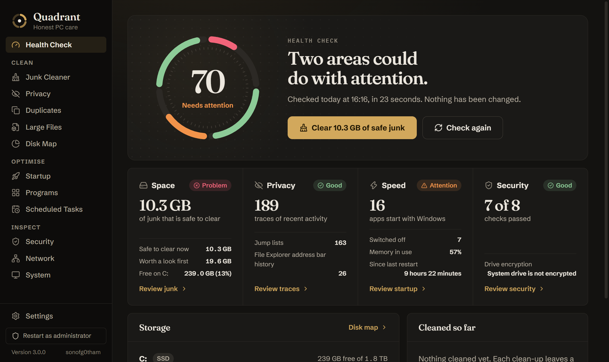
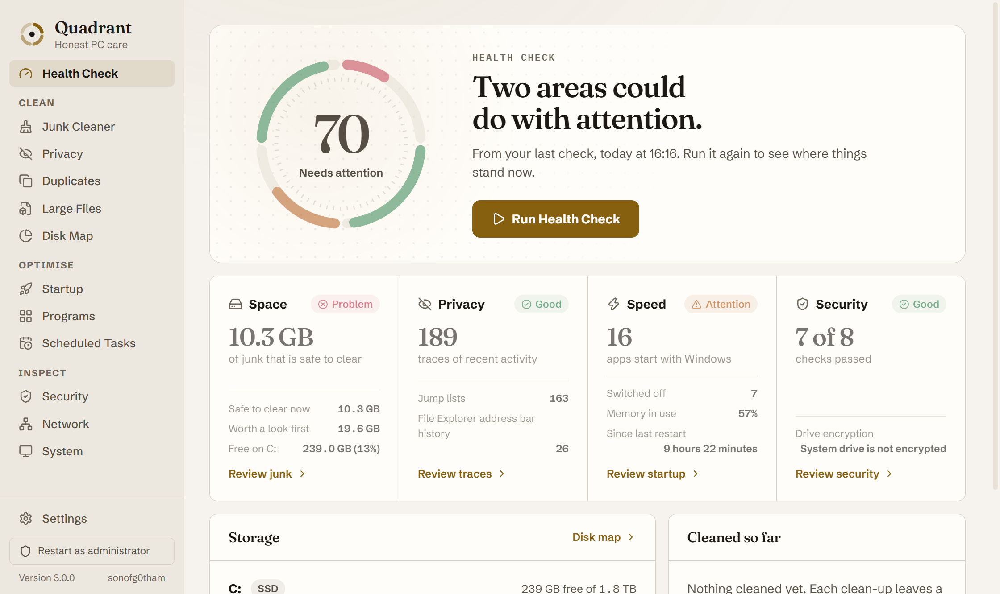

# Quadrant

**Honest PC care for Windows. One Health Check, four areas, no scare tactics.**

Quadrant looks at your PC across four areas (Space, Privacy, Speed and Security), shows you exactly what it found, and only removes or changes something after you say so.

> Runs locally. No account, no telemetry, no upsell. Nothing leaves your machine unless you ask Gemini for advice.




## Why this exists

Most PC cleaners earn their money by worrying you. They show a big red number, hide what they are about to delete, and nag you to upgrade. Some run with administrator rights and very little care about what they touch.

Quadrant is the opposite: a small, open tool that tells you plainly what is on your PC, lets you look at every file before it goes, and treats deleting things as the risky operation it is.

## How Quadrant is different

- **It shows before it removes.** Every category can be opened to see the files inside. Nothing is cleared by a scan.
- **No invented urgency.** The score is worked out from four plain measures. Red is only used when something is actually wrong.
- **Security settings are read-only.** Quadrant reports on antivirus, firewall, drive encryption and the rest, then opens the right Windows page. It never changes them itself.
- **Built to be safe when elevated.** See the safety model below.
- **One portable file.** About 13 MB, no installer, no background service.

## Features

### Health Check

One pass over all four areas, with a score out of 100 and a dial that shows each area separately. It only reads. You then choose what to act on.

### Clean

- **Junk Cleaner**: temporary files, Windows Update downloads, thumbnail cache, crash dumps, old logs, Prefetch data, the Recycle Bin, browser caches (Chrome, Edge, Brave, Firefox) and developer caches (NuGet, npm, pip).
- **Privacy**: recent files list, jump lists, and File Explorer and Run box history.
- **Duplicates**: compares file contents, not names. One copy of every file is always kept.
- **Large Files**: biggest files first, with where each one lives.
- **Disk Map**: measures a drive or folder once, then lets you step in and out.

### Optimise

- **Startup**: see and switch off apps that start with Windows.
- **Programs**: installed programs, with a button that starts each program's own uninstaller.
- **Scheduled Tasks**: view tasks and enable or disable them.

### Inspect

- **Security**: eight protection checks, each linked to the Windows page where you can change it.
- **Network**: adapters and connections.
- **System**: hardware, Windows version, memory and uptime.

### Optional Gemini advice

Add your own Google Gemini API key in Settings to get plain-English advice on a scan. The key is stored in Windows Credential Manager, never in a file, and is never passed to the interface layer. Without a key, no AI request is made.

## Safety model

Deleting files with administrator rights is where cleaners do damage, so the rules are strict and each one has a test:

- The interface can only ask for things by id, never by file path. Ids are checked in the Rust core against a fixed allowlist of categories or the scan it just ran.
- Deleting never follows junctions or symlinks, and never removes a category's root folder.
- Windows system locations are protected and cannot be removed through Duplicates or Large Files.
- Files that changed since the scan are skipped. Locked files are counted as skipped, not forced.
- The web view has a strict Content Security Policy, no Tauri plugins, and builds every element from text, never from HTML strings, because file and program names are untrusted.
- Release builds ignore the WebView2 override environment variables.

## Status

Version 3.0.0 is a full rebuild in Rust. The old Python app (2.1) is kept in `legacy/` and is no longer built.

Checked so far on one Windows 11 PC: Health Check, the Junk Cleaner scan, Startup, Security, and duplicate removal on test files. Not yet checked: a full junk or privacy clean on a real machine, running as administrator, and the Gemini call. Scheduled Tasks currently needs Windows in English. Treat it as a beta.

## Prerequisites

- **Windows 10 or 11** with the WebView2 runtime (included with Windows 11 and current Windows 10)
- **Rust** to build from source - [rustup.rs](https://rustup.rs)

## Quick Start

```bat
:: Build and run a debug copy
run.bat

:: Build the portable release to dist\Quadrant.exe
build.bat
```

For a full clean of system folders, right-click the EXE and choose **Run as administrator**, or use the button inside the app.

## Project Structure

```
quadrant/
├── crates/core/     # quadrant-core: all scanning, cleaning and inspection logic. No UI code.
├── src-tauri/       # The app shell. commands.rs lists everything the interface may call.
├── ui/              # The interface: plain HTML, CSS and JS modules. No bundler, no npm.
├── tools/           # Dev scripts: icon sprite builder and a screenshot driver.
├── legacy/          # The old Python 2.1 app, parked.
├── brand.md         # Design direction, fonts and palette.
└── AGENTS.md        # AI assistant project context.
```

## Testing

98 unit tests cover the core, including every deletion rule. They use temporary folders and scratch registry keys only, never real system locations:

```bat
cargo test -p quadrant-core
```

To preview the interface on mock data without building the app, serve the `ui/` folder and open it in a browser.

## Tech Stack

Rust, Tauri 2, WebView2, plain HTML/CSS/JavaScript. Typefaces: Fraunces, Schibsted Grotesk and IBM Plex Mono (SIL Open Font Licence). Icons: Lucide (ISC).

## Licence

MIT. See [LICENSE](LICENSE).
